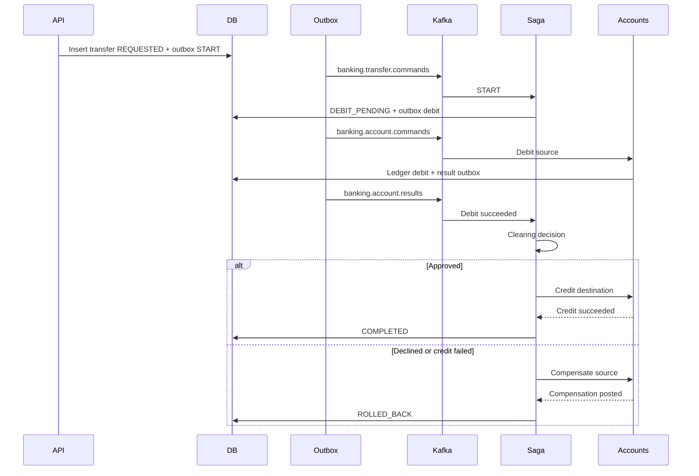

# spring-kafka-banking-engine

An event-driven, fault-tolerant financial mock backend. It accepts transfer commands, posts them through asynchronous Kafka streams, and rolls a debit back when a later step fails.

This is a mock. It does not move real money.

[](https://github.com/stackmesh/spring-kafka-banking-engine/actions/workflows/ci.yml)

## Stack

Java 21, Spring Boot 4.1, Spring Cloud Circuit Breaker (Resilience4j), Apache Kafka, Spring Data JPA with Hibernate, Liquibase, PostgreSQL.

## What it demonstrates

- **Transactional outbox.** Account and transfer changes commit in the same database transaction as the message that announces them. The publisher never dual-writes to Kafka.
- **Per-account ordering.** Debit, credit, and compensation commands are keyed by account id, then applied under `SELECT … FOR UPDATE`.
- **Idempotent consumers.** Every command id is deterministic and recorded in an inbox, so Kafka redelivery cannot post twice.
- **Strict rollback.** A declined clearing decision or a failed credit compensates the original debit. A failed compensation stays `COMPENSATION_PENDING` and is retried rather than being marked settled.
- **Append-only ledger.** Balances change only through ledger postings. The database rejects a negative balance.
- **Fault isolation.** The mock clearing house sits behind a Resilience4j circuit breaker. Business declines roll back. Technical outages retry.

## Flow



| Topic | Key | Payload |
| --- | --- | --- |
| `banking.transfer.commands` | transfer id | `START` |
| `banking.account.commands` | account id | `DEBIT`, `CREDIT`, or `COMPENSATE` |
| `banking.account.results` | transfer id | success or a failure code |
| `*.dlt` | original key | records that exhausted retries |

Poison payloads (invalid JSON, unknown signals) go to the dead-letter topic without retry. Compensation failures and clearing outages retry, then land on the dead-letter topic with the transfer left uncommitted.

## Run it

Requirements: Java 21 and Docker. The Maven Wrapper (`./mvnw`) is included.

```bash
docker compose up -d
./mvnw spring-boot:run
```

Postgres is on `localhost:5432` (`banking` / `banking`). Kafka is on `localhost:9092`. Kafka UI is on [http://localhost:8085](http://localhost:8085). The API is on [http://localhost:8080](http://localhost:8080). Health is at `/actuator/health`.

```bash
SOURCE=$(curl -s -X POST localhost:8080/api/v1/accounts \
  -H 'Content-Type: application/json' \
  -d '{"holderName":"Ada Lovelace","currency":"USD","openingBalance":"1000.00"}' | jq -r .id)

DEST=$(curl -s -X POST localhost:8080/api/v1/accounts \
  -H 'Content-Type: application/json' \
  -d '{"holderName":"Grace Hopper","currency":"USD","openingBalance":"0.00"}' | jq -r .id)

curl -s -D - -X POST localhost:8080/api/v1/transfers \
  -H 'Content-Type: application/json' \
  -H "Idempotency-Key: $(uuidgen)" \
  -d "{\"sourceAccountId\":\"$SOURCE\",\"destinationAccountId\":\"$DEST\",\"amount\":\"25.50\",\"currency\":\"USD\"}"
```

The create call returns **202 Accepted** with status `REQUESTED`. Poll `GET /api/v1/transfers/{id}` until it is `COMPLETED`, `FAILED`, or `ROLLED_BACK`.

A transfer whose amount ends in `.13` is declined by the mock clearing house. The source account is debited and then compensated, and the transfer finishes as `ROLLED_BACK` with `failureCode` `CLEARING_REJECTED`.

Set `banking.clearing.mode` to `ALWAYS_APPROVE`, `ALWAYS_REJECT`, `DETERMINISTIC` (the default), or `UNAVAILABLE`. `UNAVAILABLE` trips the circuit breaker. Those transfers stay `DEBIT_PENDING` and retry instead of settling.

## API

| Method | Path | Result |
| --- | --- | --- |
| `POST` | `/api/v1/accounts` | `201` open an account |
| `GET` | `/api/v1/accounts/{id}` | current balance |
| `GET` | `/api/v1/accounts/{id}/ledger` | append-only postings |
| `POST` | `/api/v1/accounts/{id}/freeze` | block new debits and credits |
| `POST` | `/api/v1/accounts/{id}/unfreeze` | restore an active account |
| `POST` | `/api/v1/transfers` | `202` accept a transfer. Requires `Idempotency-Key` |
| `GET` | `/api/v1/transfers/{id}` | poll the saga |

Repeating an idempotency key with the same body returns **200** and the original transfer. The same key with a different body returns **409**. Frozen accounts, currency mismatches, and same-account transfers are rejected before a message is written. Insufficient funds is accepted and then fails inside the account consumer. The source row is locked for the debit, so two racing transfers cannot overdraw it.

Money is a `BigDecimal` with scale 2. Supported currencies are `USD`, `EUR`, and `GBP`. There is no FX.

## Tests

```bash
./mvnw test
```

Unit tests cover the saga transitions, balance rules, and the `.13` clearing rule. `TransferFlowTest` starts PostgreSQL and Kafka with Testcontainers and is skipped when Docker is not available. With Docker, `./mvnw test` also runs a settled transfer, a clearing rollback, an insufficient-funds failure, idempotency, and two concurrent debits against one balance.

## Layout

```
api/          HTTP, validation, problem details
account/      balances, row locks, command handler
ledger/       append-only postings
transfer/     acceptance, saga, state machine
outbox/       claim with SKIP LOCKED, publish, retry
inbox/        processed command ids
clearing/     mock clearing house and circuit breaker
messaging/    topics and Kafka listeners
```

## Design notes

The outbox is the consistency boundary. A saga step and the command it emits commit together. The publisher claims rows with `FOR UPDATE SKIP LOCKED`, so a second instance can drain the same table without double-publishing a claimed row. If the process dies after Kafka accepts a record and before the row is marked published, the claim times out, the row returns to `PENDING`, and consumers drop the duplicate by command id.

Command ids are `UUID.nameUUIDFromBytes(transferId + ":" + commandType)`. Redelivery of `START` finds the transfer already past `REQUESTED` and does not enqueue a second debit.

Compensation is a credit that is allowed on a frozen account. A closed account cannot be compensated; that command retries and, after the listener gives up, remains visible as `COMPENSATION_PENDING` plus a dead-letter record. The transfer is never marked `ROLLED_BACK` or `COMPLETED` until the ledger agrees.

## License

MIT.
